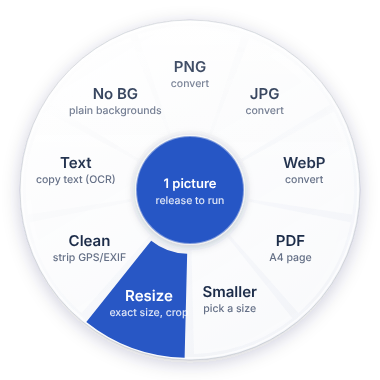

# Droppo (v0.9)

**Drop it. Done.** Droppo is a small Windows utility for everyday file jobs. Drag a file, hold **Shift**, and a wheel of actions pops up under your cursor. Release on a slice and the result lands next to the original (or in a folder you pick in Settings). Nothing is uploaded, nothing is overwritten.

For PDFs there's also **PDF Studio**: a window where you see every page, drag them into order, delete, rotate, merge files, and edit pages (text in any of your fonts, your saved signature, highlights, white-out, replacing existing text) and fill in PDF forms.



*(Design preview drawn from the app's own colours and geometry.)*

## Install (for anyone)

1. Download **`Droppo-Setup-<version>.exe`** from the [Releases page](https://github.com/YmirKhussan/droppo/releases/latest) and double-click it.
2. Windows may say "Windows protected your PC" because the app isn't code-signed yet. Click **More info** > **Run anyway**.
3. Click Install. No admin password needed, nothing else to install: .NET, FFmpeg and qpdf are inside.

A welcome window explains the basics. Had the old CursorConvert installed? The installer removes it, and Droppo brings over your settings and saved signature. Uninstall from Settings > Apps like any other app.

Optional extras the installer can't include:
- **Word/PowerPoint/Excel to PDF** uses Microsoft Office if it's installed. No Office? Install LibreOffice (free).
- **Text recognition (OCR)** uses the languages installed in Windows (Settings > Time & language > Language).

## Make the installer (you, once per version)

**Easiest: let GitHub build it.** Bump `<Version>` in `src\Droppo\Droppo.csproj` (for example to `0.6.1`) and push to `main`. GitHub builds the installer on Windows and publishes it as release `v0.6.1` on the Releases page. Pushes that don't change the version still get built (handy as a check) but don't make a release. You can also run it by hand: Actions tab > **Build installer** > Run workflow (the .exe appears under the run's Artifacts).

**On your own PC:** double-click **`build-installer.bat`**. It:
1. installs the .NET SDK and Inno Setup with winget if they're missing,
2. builds the app with .NET bundled in (self-contained),
3. downloads FFmpeg (gyan.dev essentials build, checksum checked) and copies qpdf from your PC (installs it with winget if needed),
4. makes `dist\Droppo-Setup-<version>.exe` and opens the folder.

First run takes a few minutes. The FFmpeg download is cached in `dist\downloads`; run `build-installer.bat -Fresh` to get a newer FFmpeg. Bump `<Version>` in `src\Droppo\Droppo.csproj` before building a new release: installing a newer version over an old one just updates it, settings are kept.

**Tinkering**: `run.bat` still builds and runs straight from the code (needs the .NET SDK, FFmpeg and qpdf on your PC). Close the installed copy first (tray > Quit Droppo), only one can run at a time.

## The main window

Open Droppo from the Start menu (or click its icon by the clock). Drop files onto the big drop zone, or click it to browse, and Droppo shows everything it can do with them, grouped into Convert, Compress, PDF, Organise and Tools. Click one to run it. The sidebar filters by group and has PDF Studio and Settings.

## Use the wheel

1. Start dragging a file (or several) in Explorer or on the Desktop.
2. **Then** hold Shift. Pressing Shift *before* you click changes your selection in Explorer, so do it mid-drag.
3. Move onto a slice and let go. Centre of the wheel = cancel. Let go of Shift = cancel.
4. A small card by the clock says "All done." with **Show in folder** and **Open**. Slow jobs (big videos) show "Working on it..." first. If something fails, it says what went wrong in plain words, with **Details** for the log.

Not working? Tray icon > **Test the wheel**: it opens the wheel in the middle of the screen so you can drag onto it without Shift.

### What's on the wheel

The slices change depending on what you drag. Formats you already have are hidden (no "PNG" slice for a PNG).

| Dragging | Slices |
|---|---|
| Images | PNG, JPG, WebP, PDF, Smaller, **Resize**, Clean, **No BG**, Text (one image) / Arrange + **Rename** (several) |
| Video | MP4, GIF (first 20s), MP3, Smaller, **Trim** (one clip), **Rotate**, Mute, Frame, **Join** + Rename (several) |
| Audio | MP3, WAV, M4A, FLAC, Louder, Smaller, **Trim** (one file) / **Join** + Rename (several) |
| PDF | **Studio**, **Merge** (2+ PDFs), JPG, PNG, Split, Smaller, Lock, Text, Rotate, Rename (several) |
| Word / PowerPoint / Excel | PDF, 1 PDF (combine several), Studio, ZIP, copy paths/names |
| Images + PDFs + docs together | PDF (combine all), Studio, ZIP, copy paths/names |
| Anything else | ZIP, Rename, copy full paths, copy file names |

Notes:
- **Smaller** asks how small: a size in MB, or a % of the original (quick picks: 25/50/75%, 1/2/5/10 MB). It remembers your last choice. With several files the target applies to each one.
  - Images: lowers quality first, then resolution, until it fits.
  - PDFs: tries a lossless repack first (text stays selectable). If that's not enough, pages become compressed images. Text-only PDFs are already compact, so if the target is out of reach you get the smallest possible version and the notification says how close it got.
  - Video: two-pass encode aimed at the exact size; lowers the resolution when the size is too tight for full HD.
  - Audio: MP3 at the bitrate that fits (mono for very small targets).
- **Resize** asks for the size: quick picks (passport photo 413×531, 600×600, Instagram square/portrait, Full HD, 50%, 25%, app icon .ico) or your own width × height. **Crop** fills the size exactly (trims the edges), **Fit** keeps the whole picture (adds white or transparent bars).
- **No BG** removes plain backgrounds (logos, product shots, signatures on white paper) and saves a transparent PNG. Busy photo backgrounds are refused rather than done badly.
- **Trim** shows the first and last frame while you set start and end (sliders or type `1:23.5`).
- **Join** asks for the order first. Clips with different sizes are fitted onto the first clip's size.
- **Rotate** (video) turns it 90° clockwise, for phone videos filmed sideways.
- **Rename** renames many files at once with a live preview: `#` is a number (`###` = 001), `{name}` the old name, `{date}` the file's date. Changed your mind? Tray > **Undo last rename**.
- **Clean** removes GPS location, camera info and text tags. Lossless for JPG and PNG.
- **Text** reads text with OCR (works on photos and scans too), copies it to the clipboard and saves a .txt next to the file.
- **Lock** adds a password to a PDF. On a locked PDF it asks for the password and saves an unlocked copy.
- **Merge**, **Studio** and **Arrange** open PDF Studio so you can set the order before saving.
- Every PDF slice works on password-protected PDFs: it asks for the password first.

## PDF Studio

Open it from a wheel slice, or tray menu > **Open PDF Studio**, then drop files in.

**Pages view**
- Drag pages to reorder. Drop more PDFs, images or Office files anywhere to add them (that's how you merge).
- Click to select, Ctrl+click or Shift+click for several. `Del` deletes, `Ctrl+Z` undoes, `Ctrl+A` selects all, `Ctrl+R` rotates.
- Right-click a page: edit, rotate, duplicate, insert blank page, extract, delete.
- **Extract** saves just the selected pages as a new PDF.
- **More**: page numbers, watermark, password, make scanned pages searchable (OCR).
- **Save** (`Ctrl+S`) writes a new PDF next to the original (`-edited` or `-combined`), or where Settings says. Your originals are never changed.

**Editing a page** (double-click it)

| Tool | Key | What it does |
|---|---|---|
| Select | V | Click something you added, drag to move, `Del` to remove, double-click text to retype |
| Text | T | Click anywhere and type |
| Replace | R | Drag a box over existing words: it reads them, covers them, and lets you retype |
| White-out | W | Drag to cover anything. The patch takes the colour of the page around it (cream paper, coloured headers) |
| Highlight | H | Drag over text |
| Draw | D | Freehand drawing |
| Sign | S | Click to stamp your saved signature. First time, it asks you to draw it once. Right-click the button to redraw |
| Image | I | Click to place a picture, logo or signature image (transparency kept) |

Colours (black, blue, red), the **font list** and A− / A+ (text, image and signature size) are on the top right. The font list has the fonts installed on your PC that allow embedding; the font is built into the saved PDF so it looks the same everywhere.

**Forms**: if the PDF has fillable boxes, they show up light blue in the editor. Click and type, tick checkboxes, pick from dropdowns. On save the answers are printed onto the page (flattened), so they show in every viewer and can't be changed by accident. `PageUp` / `PageDown` move between pages, `Esc` goes back.

**About "Replace"**: PDFs don't store editable paragraphs, so no lightweight tool can truly retype the original font. Replace reads the words with OCR, covers them with a patch in the page's own background colour, and puts your new text on top in a matching size. Works best on plain backgrounds.

**Limits**: added text supports Western characters only (the PDF's built-in encoding). Arabic, Jawi and Chinese text can't be typed in yet.

## Settings

Click the tray icon (or open Droppo from the Start menu while it's running):
- key to hold while dragging (Shift, Ctrl, Alt) and Start with Windows
- where results go: next to the original, always one folder (default `Downloads\Droppo`), or ask every time
- PDF-to-picture sharpness and GIF length
- helper programs: shows whether FFmpeg, qpdf and LibreOffice were found, with a Browse button if yours live somewhere unusual
- your saved signature: redraw or delete
- look and feel: frosted glass windows (Windows 11) and animations, each can be switched off

Behind the scenes it's all in `%AppData%\Droppo\settings.json`:

| Setting | Default | What it does |
|---|---|---|
| `CompressValue` / `CompressIsPercent` | 50 / true | Last target picked for Smaller |
| `TriggerKey` | Shift | Shift, Ctrl or Alt |
| `GlassEffects` / `Animations` | true / true | Frosted glass windows, short animations |
| `OutputMode` / `OutputFolder` | SameFolder | `SameFolder`, `Folder` or `Ask` |
| `FfmpegPath` / `QpdfPath` / `LibreOfficePath` | empty | Full path if auto-detect can't find the tool |
| `PdfImageDpi` | 150 | Resolution of images made from PDF pages (300 for print quality) |
| `GifMaxSeconds` | 20 | Video to GIF only uses this many seconds |
| `PdfMaxImageEdge` | 2480 | Max pixels per image inside PDFs (2480 = A4 at 300 dpi) |

Restart the app after editing the file by hand. Your signature is in `signature.json` in the same folder.

## Look and feel

- **Colours**: Cobalt Blue `#3882F6` for actions, Deep Navy `#0F2D5B` text, Ice Blue `#E8F1FF` hover and selected, Slate `#64748B` secondary text, Glass White `#FFFFFF` cards.
- **Glass**: Droppo's windows are see-through. Droppo copies what's on your screen behind each window, blurs it, and lays a light frost on top (more frost over dark wallpapers so text stays readable). The copy slides as you drag the window and refreshes when you stop or come back to it; Droppo hides itself from that copy for a split second, so it never catches itself. Switch glass off in Settings for plain windows.
- **Motion**: every animation is under 200 ms (wheel opens and hover, buttons, cards). They follow Windows' "Animation effects" setting and can be switched off in Settings.
- **Control styles** live in `src/Droppo/Theme/*.xaml` and load one file at a time. If one ever fails, that control just keeps the standard Windows look (the log says which).

## Brand files

`brand/` has the logo as SVG and PNG: app icon (`droppo-icon.svg`, 256/512/1024 PNG), symbol (cobalt and white), wordmark, light and dark logos, the README banner and a preview of the app. The icon is a white "D" with an arrow cut through it, on a blue gradient tile. The wordmark is Poppins Bold (SIL Open Font Licence) turned into outlines, so no font needs installing. The Windows icon (`src/Droppo/Assets/app.ico`) has 9 sizes; the 16 px one is drawn pixel by pixel for the tray.

## Troubleshooting

- **"FFmpeg not found"** / **"needs qpdf"**: shouldn't happen with the installer. From `run.bat`: `winget install Gyan.FFmpeg` / `winget install QPDF.QPDF`.
- **OCR / Text says it isn't available**: Windows needs a language with text recognition. Settings > Time & language > Language, make sure English (or your language) is installed.
- **Office to PDF fails**: close any open Word/PowerPoint/Excel dialogs and try again, or install LibreOffice.
- **Something failed**: tray > Open log. It has the exact error. Paste it to Claude.
- **iPhone HEIC photos**: need FFmpeg 7.1 or newer. `winget upgrade Gyan.FFmpeg`.
- **Wheel never appears**: press Shift *after* the drag started, and don't run Droppo as administrator.
- **Where is it?** Open Droppo from the Start menu: if it's already running, that opens Settings.

## Project layout

```
src/Droppo/
  Core/          the engine (no Windows UI code, tested on its own)
    ImageOps / AvOps / PdfOps / OfficeOps / TextOps / OtherOps   <- wheel actions
    ImageEditOps (resize, no bg) / MediaEditOps (trim, join, rotate) / RenameOps
    FFmpeg.cs  Qpdf.cs  ProcessRunner.cs                         <- external tools
    JpegTools  PngTools  PdfWriter  FontMetrics                   <- byte-level helpers
    Studio/
      StudioModel.cs    pages, edits, stamps
      StudioEngine.cs   loading files, saving (order > edits > rotation > stamps > password)
      OverlayPdf.cs     draws text, boxes, ink, images onto pages (embeds TrueType fonts)
      PdfForms.cs       reads and fills form fields
      Signature.cs  Fonts.cs
  Shell/         the Windows side
    DragWatcher.cs  WheelWindow.*  Tray.cs  Toast.cs  SettingsWindow.cs  WelcomeWindow.cs
    Brand.cs (logo as vectors)  Glass.cs (Mica/Acrylic + animations)  Theme.cs (loads Theme/*.xaml)
    WindowsPdfRenderer.cs  WindowsServices.cs (OCR, Office, dialogs)
    Studio/  StudioWindow.cs (pages view)  PageEditor.cs (editing)  Dialogs.cs  ToolDialogs.cs  Ui.cs (look and feel)
  Theme/         control styles: buttons, inputs, lists, menus, scrollbars, sliders
  App.xaml.cs    wires it all together
installer/
  build.ps1  Droppo.iss  THIRD-PARTY-NOTICES.txt  wizard-*.bmp   <- used by build-installer.bat
brand/           logo, icon, wordmark, banner (SVG + PNG)
```

## Next

- Arabic / Jawi / Chinese text in edits
- "IC front + back on one A4 page"
- Recipes: chain steps into one slice (e.g. "client logo pack")

## Before selling it

- **Name**: before charging money, check "Droppo" for trademarks and existing apps (Microsoft Store, other app stores, domain names).
- **FFmpeg licence**: the installer now bundles a GPLv3 FFmpeg build as a separate program, with a notice and source links (`THIRD-PARTY-NOTICES.txt`). That's the normal way to share it for free. Selling is allowed under the GPL too, but with conditions; get proper advice before charging money.
- **qpdf licence**: Apache 2.0, bundled with its notice.
- **Code signing**: unsigned installers trigger the SmartScreen warning. A code-signing certificate removes it once it builds reputation. Costs money every year, so leave it until you sell.

## Licence

Copyright (c) 2026 Amir Hassan. All rights reserved. The code is public to read, not to reuse; see `LICENSE`. Bundled tools keep their own licences (`installer/THIRD-PARTY-NOTICES.txt`).
